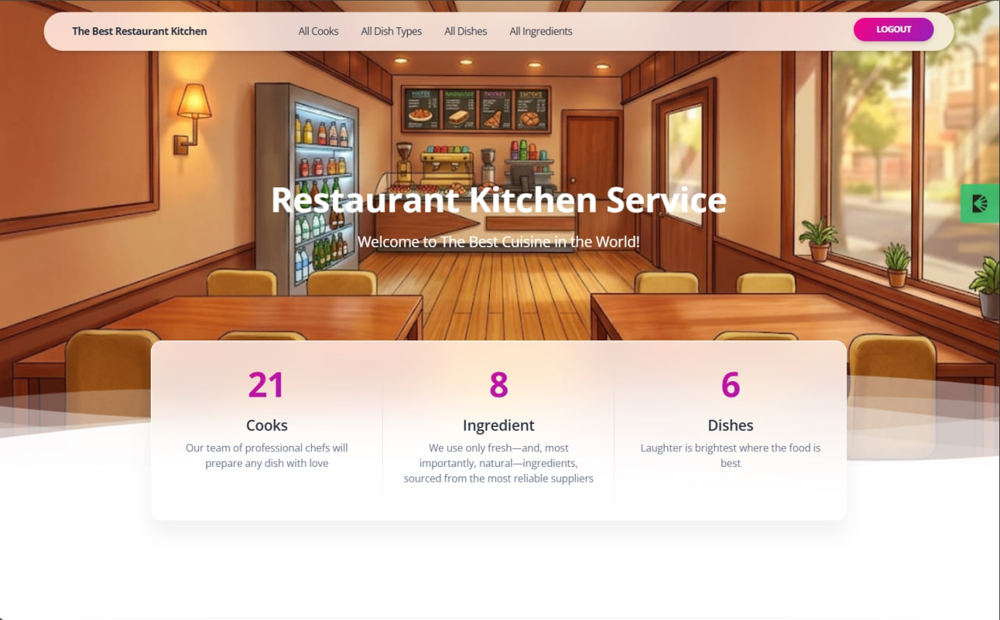

# Restaurant-Kitchen-Service

Django project for managing a restaurant kitchen, designed to improve communication and establish guidelines among the chefs in the kitchen.

## Features

In this system, chefs can create new dishes and dish categories, as well as designate the chefs responsible for preparing each dish and specify the ingredients for a particular dish.

This project implements the following features of the Django interface:
	
	* View a list of chefs, their experience, and more. 
	  View detailed information about chefs, including the dishes they prepare,
	  dish types, and their experience. 
	  A search function for chefs by username has been implemented.

	* View a list of dishes, their types, and prices. 
	  View detailed information about a dish, 
	  including its name, description, price, who prepared it, and its ingredients. 
	  A search for dishes by name has been implemented.

	* View a list of dish types; create, update, and delete them. 
	  A search by dish type name has also been implemented.
	  
	* View a list of ingredients; create, update, and delete them.

## Installation

Python3 must be already installed

```shell
git clone https://github.com/Vladislav-Glazunov/restaurant-kitchen-service.git
cd restaurant-kitchen-service
python -m venv venv
venv\Scripts\activate (on Windows)
source venv/bin/activate (on macOS)
pip install -r requirements.txt
python manage.py runserver  # starts Django Server
```

## Demo

